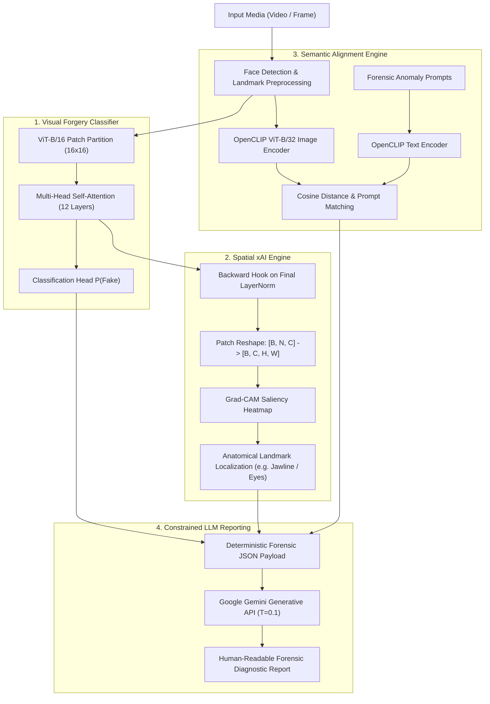

# Explainable Deepfake Detection with Vision Transformers & Multimodal VLMs

[](https://www.python.org/)
[](https://pytorch.org/)
[](https://github.com/huggingface/pytorch-image-models)
[](https://github.com/jacobgil/pytorch-grad-cam)
[](https://github.com/mlfoundations/open_clip)
[](https://ai.google.dev/)
[](LICENSE)

An end-to-end multimodal deepfake inspection framework that replaces opaque binary scores with **localized spatial attention heatmaps** (Grad-CAM on Vision Transformers), **semantic prompt alignment** (OpenCLIP), and **human-auditable forensic diagnostic reports** generated by constrained Vision-Language translation (Google Gemini API).

---

## System Architecture



---

## Key Features

1. **Vision Transformer (ViT-B/16) Classifier**:
   - Utilizes `vit_base_patch16_224` pretrained on ImageNet-1k, fine-tuned for facial artifact detection.
   - Operates on $16 \times 16$ spatial patches to detect high-frequency boundary anomalies, skin texture inconsistencies, and warping seams.
2. **Transformer Grad-CAM Spatial Localization**:
   - Solves the 1D token sequence problem in Transformers: discards the `[CLS]` token and dynamically reshapes tokens $[B, N, C] \rightarrow [B, C, \sqrt{N}, \sqrt{N}]$ before bilinear upsampling to $224 \times 224$.
   - Automatically maps peak activation coordinates to facial anatomical landmarks (jawline seam, periorbital eye region, mouth dynamics).
3. **Multimodal CLIP Semantic Alignment**:
   - Employs OpenCLIP (`ViT-B-32`) to project visual facial features and targeted forensic textual hypotheses into a shared latent space.
   - Evaluates cosine similarity against prompts describing natural vs. synthetic manipulation characteristics.
4. **Grounded LLM Forensic Reporting (Gemini API)**:
   - Uses Google Gemini (`gemini-1.5-flash` / `gemini-pro`) constrained by low temperature ($T=0.1$) to convert structured model evidence into objective, audit-ready diagnostic reports.
   - **Zero Hallucination Guarantee**: The LLM never classifies; it translates deterministic JSON evidence into natural language.
5. **Group-Aware Video-Level Temporal Aggregation**:
   - Implements strict video-level stratified partitioning ($70\%$ train, $15\%$ val, $15\%$ test) to guarantee **zero identity or background leakage** across frames.
   - Evaluates both frame-level decisions and video-level temporal mean pooling:
     $$S_{\text{video}} = \frac{1}{M} \sum_{i=1}^{M} P(\text{Fake} \mid \text{frame}_i)$$

---

## Datasets & Benchmark Compatibility

### Open Benchmark Used for Prototyping
For rapid, open reproducibility without academic access approval barriers, this prototype was trained and benchmarked on the [Kaggle Deepfake Detection Dataset](https://www.kaggle.com/datasets/aframannan/deepfake-detection) (`aframannan/deepfake-detection`):
- **196 video folders** (98 real, 98 fake).
- **2,940 cropped face frames** (~15 frames per video).
- **Stratified video split**: 68 train videos (2,040 frames), 15 validation videos (450 frames), 15 test videos (450 frames).

### Modular Compatibility with Standard Benchmarks
The data ingestion pipeline in `src/data/dataset.py` is architected to ingest benchmark datasets out of the box:
- **FaceForensics++ (FF++)**: Supports raw (c0), light (c20), and heavy (c40) compression directories across Deepfakes, Face2Face, FaceSwap, and NeuralTextures.
- **Celeb-DF (v2)** & **WildDeepfake**: Standardized folder mapping for cross-manipulation transfer testing.

---

## Experimental Results

The model was trained for 3 epochs with AdamW ($\text{LR} = 2 \times 10^{-5}$, weight decay $= 0.01$) on an NVIDIA Tesla T4 GPU:

| Metric | Frame-Level (450 frames) | Video-Level (15 videos) |
|---|---:|---:|
| **Accuracy** | **92.89%** | **93.33%** |
| **Precision** | **87.39%** | **87.50%** |
| **Recall** | **99.05%** | **100.00%** |
| **F1-Score** | **92.86%** | **93.33%** |
| **ROC-AUC** | **99.82%** | **100.00%** |

### Training History & Critical Analysis
```
Epoch 01/03 | Train Loss: 0.2270, Train Acc: 88.82% | Val Loss: 0.9483, Val Acc: 70.00%
Epoch 02/03 | Train Loss: 0.0266, Train Acc: 98.63% | Val Loss: 1.3314, Val Acc: 70.89%
Epoch 03/03 | Train Loss: 0.0203, Train Acc: 99.02% | Val Loss: 1.0538, Val Acc: 74.89%
```
> [!NOTE]
> **Scientific Reflection**: While frame training accuracy rapidly converges to 99.02%, validation loss rises after epoch 1, indicating memorization of dataset-specific artifacts. Future iterations should utilize Parameter-Efficient Fine-Tuning (LoRA) and forensic data augmentations (JPEG compression, Gaussian blur). Furthermore, the 15-video test set represents an exploratory proof-of-concept rather than an exhaustive benchmark.

---

## Quickstart & Installation

### 1. Clone & Set Up Environment
```bash
git clone https://github.com/<your-username>/explainable-deepfake-vlm.git
cd explainable-deepfake-vlm

python -m venv venv
# On Windows:
.\venv\Scripts\activate
# On Linux/macOS:
source venv/bin/activate

pip install -r requirements.txt
```

### 2. Configure Gemini API (Optional)
To enable live LLM report generation via Google Gemini, set your API key:
```bash
# On Windows PowerShell:
$env:GEMINI_API_KEY="your-gemini-api-key"

# On Linux/macOS:
export GEMINI_API_KEY="your-gemini-api-key"
```
*(If no API key is provided, the system automatically runs the built-in deterministic forensic translation engine.)*

### 3. Run the End-to-End Demo
Test the complete pipeline immediately on pre-packaged sample data:
```bash
python demo.py
```
This runs inference, generates the Grad-CAM heatmap in `outputs/gradcam_explanation.png`, computes CLIP prompt similarities, and prints the generated forensic diagnostic report.

---

## Training & Evaluation

### Acquire Full Dataset
```bash
# Automated via Kaggle CLI:
python download_data.py --download

# Or manually download from:
# https://www.kaggle.com/datasets/aframannan/deepfake-detection
# and extract folders into data/
```

### Train Vision Transformer
```bash
python train.py --data_dir data/ --epochs 3 --batch_size 16 --lr 2e-5
```

### Benchmark Evaluation (Frame & Video Level)
```bash
python evaluate.py --data_dir data/ --checkpoint outputs/best_vit_model.pth
```

---

## Sample Forensic Diagnostic Report

Below is an authentic sample output generated by the LLM translation layer:

```markdown
### Forensic Diagnostic Summary
- **Verdict**: **SYNTHETIC MANIPULATION DETECTED** (Confidence: 94.20%)
- **Attribution Localization**: Peak Grad-CAM saliency concentrated at **Mandibular line (Jawline / Chin blending boundary)** (pixel coordinates: x=112, y=174).
- **Multimodal Semantic Alignment**: Closest semantic prompt match was *"A face with unnatural blending boundary and warping artifacts."* with a cosine similarity of 0.7240.
- **Forensic Assessment**: Visual boundary discrepancies and high-frequency texture discontinuities along the jawline strongly indicate generative face-swapping or neural boundary synthesis.
```

---

## Repository Structure

```
Explainable-deepfake-vlm/
├── .gitignore
├── requirements.txt                      # Dependencies (torch, timm, open_clip, grad-cam, gemini)
├── README.md                             # Comprehensive technical dossier
├── download_data.py                      # Kaggle dataset downloader & sample generator
├── train.py                              # Modular ViT training pipeline
├── evaluate.py                           # Dual-level frame & video evaluation script
├── demo.py                               # End-to-end CLI inspection demo
├── src/
│   ├── config.py                         # Hyperparameters, prompts, and directories
│   ├── data/
│   │   └── dataset.py                    # Video-level dataset, transforms, and leak-free split
│   ├── models/
│   │   ├── vit_detector.py               # ViT-B/16 classifier architecture
│   │   └── clip_analyzer.py              # OpenCLIP multimodal prompt similarity engine
│   ├── explainability/
│   │   ├── gradcam.py                    # ViT Grad-CAM with token reshape & anatomy localization
│   │   └── llm_explainer.py              # Gemini API forensic report translator
│   └── evaluation/
│       └── metrics.py                    # Frame/video metrics, ROC-AUC, confusion matrices
├── sample_data/                          # Realistic sample frames for instant offline demo
│   ├── real/sample_video_01/
│   └── fake/sample_video_02/
├── results/                              # Transcribed experiment metrics and history
│   ├── metrics.json
│   ├── training_history.csv
│   └── video_level_confusion_matrix.csv
└── notebooks/
    └── explainable-deepfake-detection.ipynb  # Original Kaggle notebook with saved outputs
```

---

## Technical Interview Defense & FAQs

<details>
<summary><b>Q1: How do you extract Grad-CAM heatmaps from a Vision Transformer?</b></summary>
Vision Transformers do not output 2D spatial feature maps; they output a 1D sequence of patch tokens $[B, N+1, C]$ where $N = (H/P) \times (W/P)$. We register backward hooks on the final normalization layer (`model.blocks[-1].norm1`). A custom `reshape_transform` discards the class token at index 0, reshapes the remaining tokens into a 2D spatial grid $[B, \sqrt{N}, \sqrt{N}, C]$, permutes to channels-first $[B, C, H', W']$, and bilinearly interpolates to the original image dimensions.
</details>

<details>
<summary><b>Q2: Since the input is only an image, where does the text for CLIP come from?</b></summary>
The image contains no text. The text embeddings are derived from a bank of <b>predefined forensic hypotheses</b> (e.g., <i>"A face with unnatural blending boundary and warping artifacts"</i> vs. <i>"A genuine, unaltered video frame of a person"</i>). CLIP's text encoder projects these prompts into the same joint embedding space as the face image. Cosine similarity then serves as a semantic cross-check alongside the supervised ViT classifier.
</details>

<details>
<summary><b>Q3: How do you prevent the LLM from hallucinating in forensic reports?</b></summary>
The LLM never performs classification. Detection is handled entirely by the fine-tuned ViT classifier. The LLM acts solely as a deterministic translation parser constrained by a low temperature ($T = 0.1$) and a rigid intermediate JSON schema containing the classification score, Grad-CAM coordinates, and top CLIP matches. If an artifact is absent from the JSON payload, it cannot be generated in the report.
</details>

<details>
<summary><b>Q4: Why evaluate at both frame level and video level?</b></summary>
Single frames often suffer from transient lighting or motion blur, leading to false positives. Video-level aggregation applies temporal pooling across all extracted frames of a clip, providing a stable decision boundary that mirrors real-world forensic deployment.
</details>

---

## License

This project is licensed under the MIT License - see the [LICENSE](LICENSE) file for details.
